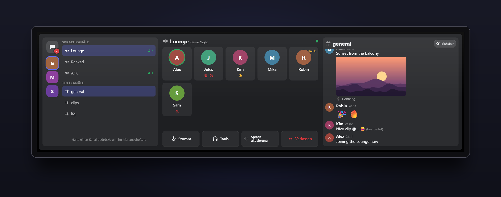
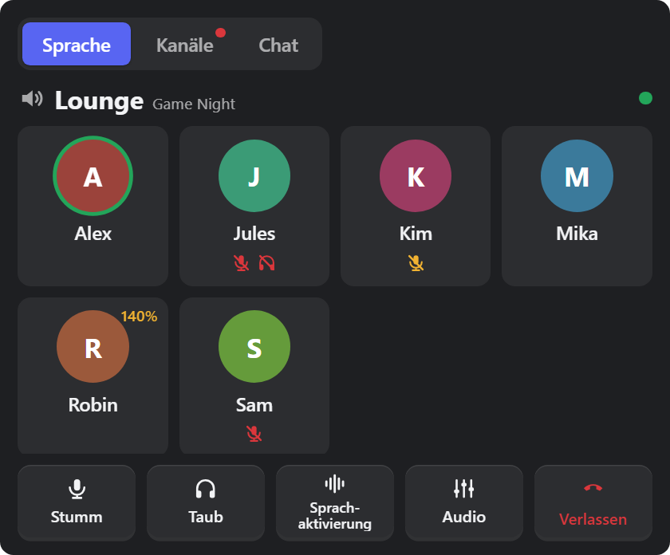
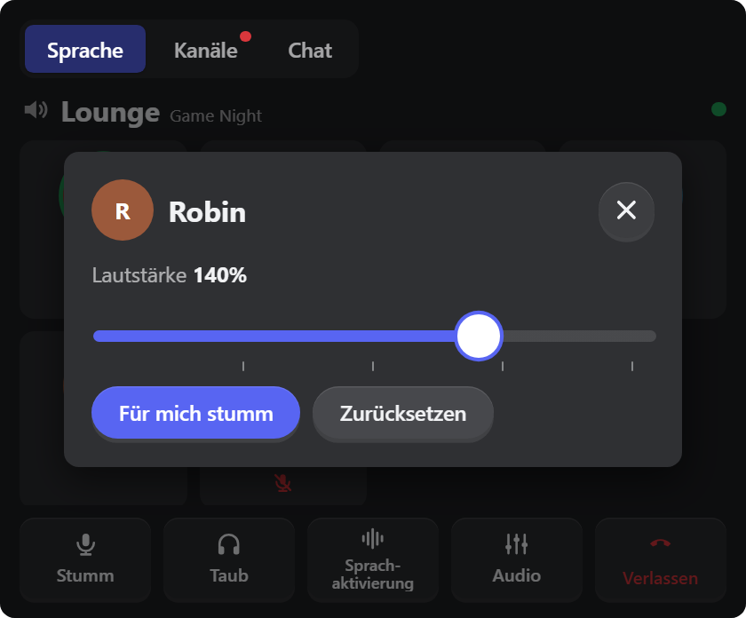
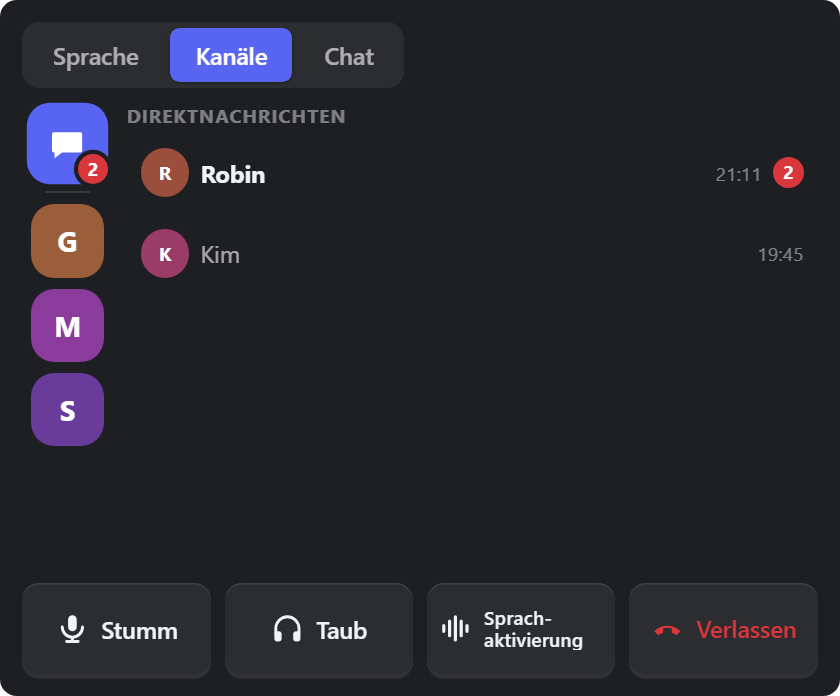
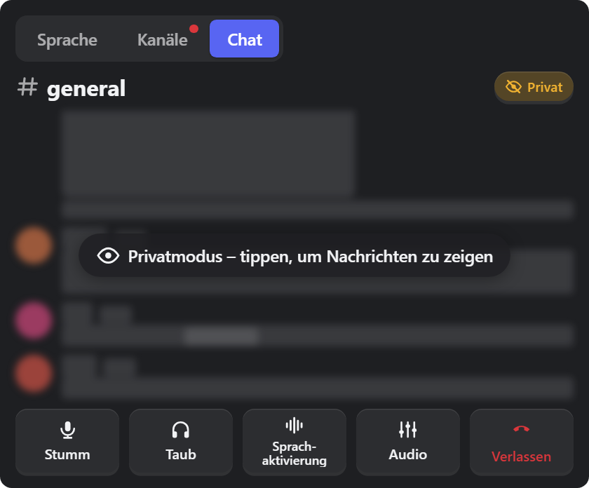
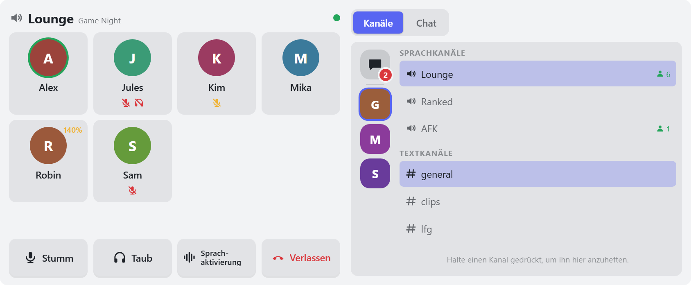
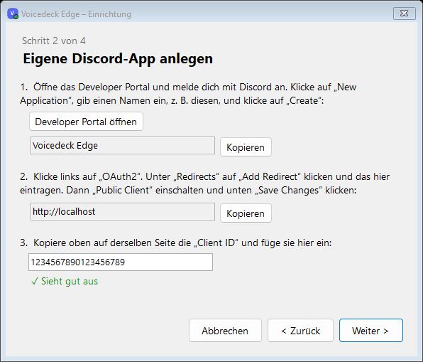

# Voicedeck Edge

**Discord griffbereit – auf der CORSAIR XENEON EDGE.**

Sieh, wer gerade spricht, schalte dich stumm, mach einen Freund leiser, wechsle den Kanal, lies den Chat und deine Direktnachrichten – direkt auf dem Touchscreen neben deiner Tastatur, ohne das Spiel zu verlassen.

Kostenlos und Open Source. Kein Konto bei uns, keine Server, kein Tracking.

> 🇬🇧 **[English version → README.md](README.md)**

**[⬇ Neueste Version herunterladen](https://github.com/KaelanTesseract/voicedeck-edge/releases/latest)** · [Anleitung](docs/SETUP.md#deutsch) · [Datenschutz](PRIVACY.md#deutsch) · [Projektseite](https://dennis-guse.de/projekte/voicedeck-edge.html)

---

## Was es kann

| | |
|---|---|
|  | **Dein Sprachkanal auf einen Blick** Alle im Kanal mit Bild und Namen. Ein grüner Ring zeigt, wer spricht, rote Symbole zeigen, wer stumm oder taub ist. |
|  | **Lautstärke für jede Person** Tippe auf jemanden, um ihn lauter oder leiser zu machen (0–200 %) oder nur für dich stummzuschalten. Bei 100 % rastet der Regler ein. |
|  | **Server, Kanäle und Direktnachrichten** Deine Server in einer Spalte wie in Discord. Tippe auf einen Sprachkanal zum Beitreten, auf einen Textkanal zum Lesen. Neue Direktnachrichten erscheinen mit rotem Zähler. |
|  | **Privatmodus fürs Streamen** Ein Tipp auf das Auge versteckt Chat-Texte, Bilder und Emojis, bis du auf den Chat tippst. |

**Außerdem dabei**

- 🎙️ **Stumm, Taub, Sprachaktivierung / Push to Talk** – große Knöpfe, die unter dem Finger einsinken.
- 📞 **Kanal verlassen** per Gedrückthalten – kein versehentliches Auflegen.
- ⭐ **Favoriten** – Kanal lange drücken, dann steht er oben.
- 🖼️ **Chat mit Bildern und Server-Emojis**, live aktualisiert.
- 🎨 **Dunkel, hell oder deine iCUE-Farben**, eigenes Hintergrundbild, einstellbare Textgröße.
- 📐 **Drei Größen:** Medium (Tabs), Large (zwei Spalten) und XL (alles nebeneinander).

---

## Was du brauchst

- Windows 10 oder 11 (64 Bit)
- CORSAIR iCUE **5.52 oder neuer** und eine **XENEON EDGE**
- Die **Discord-Desktop-App** (die installierte Version, nicht Discord im Browser)

## In vier Schritten eingerichtet (etwa 5 Minuten)

**1. Installieren.** Lade `VoicedeckEdge-Setup-….exe` von der [neuesten Version](https://github.com/KaelanTesseract/voicedeck-edge/releases/latest) herunter und starte die Datei. Admin-Rechte brauchst du nicht.
Zeigt Windows *„Der Computer wurde durch Windows geschützt“*, klicke auf **Weitere Informationen → Trotzdem ausführen** (der Installer ist nicht digital signiert).

**2. Eigene Discord-App anlegen.** Discord erlaubt diese Fernsteuerung nur über eine *eigene* (kostenlose) App. Der Einrichtungs-Assistent öffnet sich von selbst und führt dich durch – mit Kopieren-Knöpfen für alles, was du eintragen musst.

**3. Mit Discord verbinden.** Klicke im Fenster, das Discord zeigt, auf **Autorisieren**. Das ist nur einmal nötig.

**4. Widget zu iCUE hinzufügen.** Klicke im Assistenten auf **Widget zu iCUE hinzufügen** – iCUE öffnet sich und importiert es. Platziere **Voicedeck Edge** auf deiner XENEON EDGE (Größe M, L oder XL) und klicke einmal auf **Erlauben**, wenn dein PC *„Widget erlauben?“* fragt.

Fertig! Ein lila **V** in der Taskleiste zeigt, dass das Hilfsprogramm (der *Hub*) läuft; es startet mit Windows.

👉 Schritt-für-Schritt-Anleitung mit allen Details und Hilfe: **[docs/SETUP.md](docs/SETUP.md#deutsch)**

---

## Tipps

- **Kanal anheften:** gedrückt halten, bis er sich füllt. Nochmal halten löst ihn.
- **Verlassen:** *Verlassen* gedrückt halten, bis der rote Balken voll ist. (Lässt sich in den Einstellungen auf einfaches Tippen umstellen.)
- **Direktnachrichten:** Sprechblasen-Symbol oben in der Server-Spalte. Unterhaltungen erscheinen, sobald dir jemand schreibt, während der Hub läuft.
- **Hintergrundbild und eigene Farben:** in den Widget-Einstellungen zuerst **Benutzerdefinierter Stil** einschalten.
- **Seiten wechseln auf der Edge:** iCUE reicht Wischgesten über Touch-Widgets nicht weiter. Voicedeck Edge blättert deshalb selbst um – einmal einrichten: In iCUE **XENEON EDGE → Geräte-Einstellungen** öffnen und bei *Vorheriger Anzeigebildschirm* **Strg + Alt + Umschalt + Pfeil links**, bei *Nächster Anzeigebildschirm* **Strg + Alt + Umschalt + Pfeil rechts** aufnehmen. Danach einfach auf dem Widget nach links oder rechts wischen.

## Einstellungen (in iCUE)

| Einstellung | Was sie macht |
|---|---|
| Darstellung Sprachkanal | Kacheln oder Liste |
| Verlassen: gedrückt halten | Schützt vor versehentlichem Verlassen (Standard: an) |
| Wischen wechselt die Seite | Auf dem Widget nach links/rechts wischen blättert die Edge-Seiten um (braucht das iCUE-Kürzel aus den Tipps, Standard: an) |
| Chat anzeigen | Chat und Textkanäle an oder aus |
| Privatmodus | Chat startet verdeckt (auch im Widget umschaltbar) |
| Design | Automatisch (deine iCUE-Farben), Dunkel oder Hell |
| Textgröße | 80–140 % |
| Hintergrundbild, -helligkeit, Glas-Unschärfe, Transparenz | Eigener Hintergrund (mit *Benutzerdefiniertem Stil*) |

## Deine Privatsphäre

Voicedeck Edge spricht nur mit der Discord-App auf deinem PC und mit Discord selbst. Nachrichten, Bilder und Namen werden **nie gespeichert** – sie liegen nur im Arbeitsspeicher, solange sie angezeigt werden. Deine Discord-Anmeldung ist für dein Windows-Konto verschlüsselt. Keine Telemetrie, kein Tracking, keine eigenen Server.
Tray-Symbol → **Abmelden und alle Daten löschen** entfernt jederzeit alles. Details: **[PRIVACY.md](PRIVACY.md#deutsch)**

## Gut zu wissen

- Das Widget **zeigt an und steuert** – Nachrichten schreiben oder senden kannst du damit nicht.
- Kamera, Bildschirmübertragung und Soundboard werden nicht unterstützt.
- Push to Talk: Das Widget schaltet den Modus um, die Taste drücken kann es nicht.
- Kanal-Kategorien können nicht angezeigt werden (Discord gibt sie an lokale Apps nicht heraus).
- Direktnachrichten erscheinen, sobald dir jemand schreibt, während der Hub läuft; nach einem Neustart ist die Liste leer.

## Hilfe & Rückmeldung

Klappt etwas nicht? Schau zuerst in die [Fehlerhilfe](docs/SETUP.md#wenn-etwas-nicht-klappt). Kommst du nicht weiter? [Erstelle ein Issue](https://github.com/KaelanTesseract/voicedeck-edge/issues) – das Log (Tray-Symbol → *Log öffnen*) enthält keine Namen oder Nachrichten, du kannst es also anhängen.

## Entfernen

Windows-Einstellungen → **Apps** → **Voicedeck Edge** → Deinstallieren. Du wirst gefragt, ob auch alle Daten gelöscht werden sollen (inklusive Abmeldung bei Discord). Das Widget entfernst du in iCUE.

---

**Entwickler:** Bauen, Testen und wie es innen funktioniert → [docs/DEVELOPMENT.md](docs/DEVELOPMENT.md)

**Credits:** Mikro-Interaktionen nachgebaut nach [interior.dev](https://github.com/ddoemonn/interior) von ozzy (MIT) – siehe [THIRD_PARTY_NOTICES.md](THIRD_PARTY_NOTICES.md).
**Lizenz:** [MIT](LICENSE) © 2026 KaelanTesseract

Voicedeck Edge ist ein unabhängiges Projekt und steht in keiner Verbindung zu Discord Inc. oder CORSAIR. Discord, iCUE und XENEON sind Marken ihrer jeweiligen Inhaber. Die Screenshots zeigen Beispieldaten mit erfundenen Personen.
