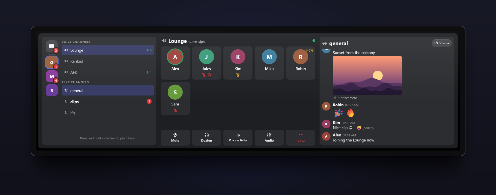
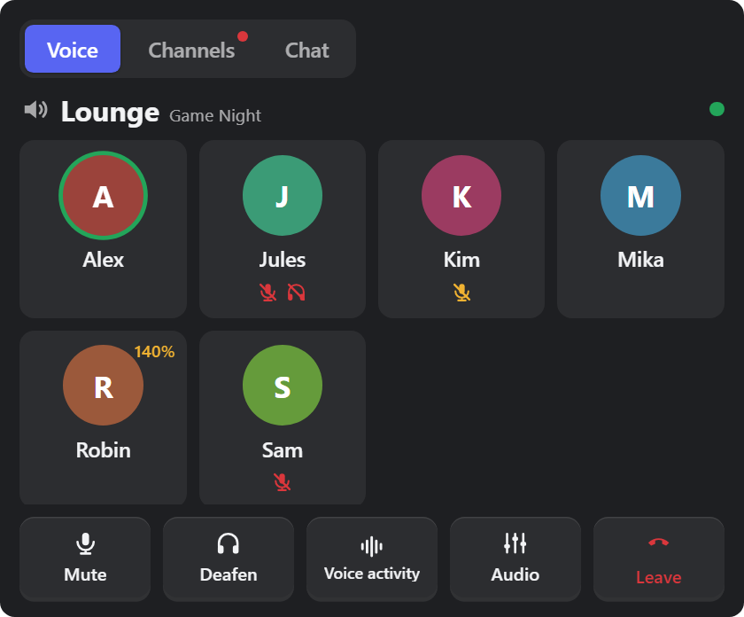
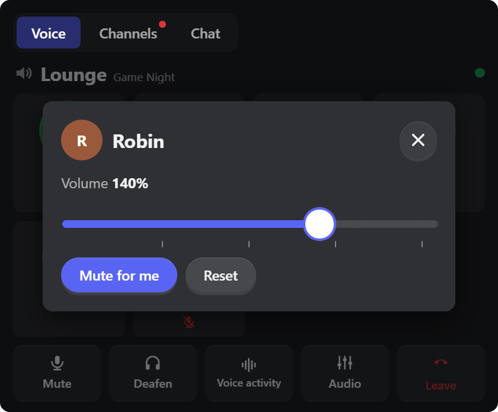
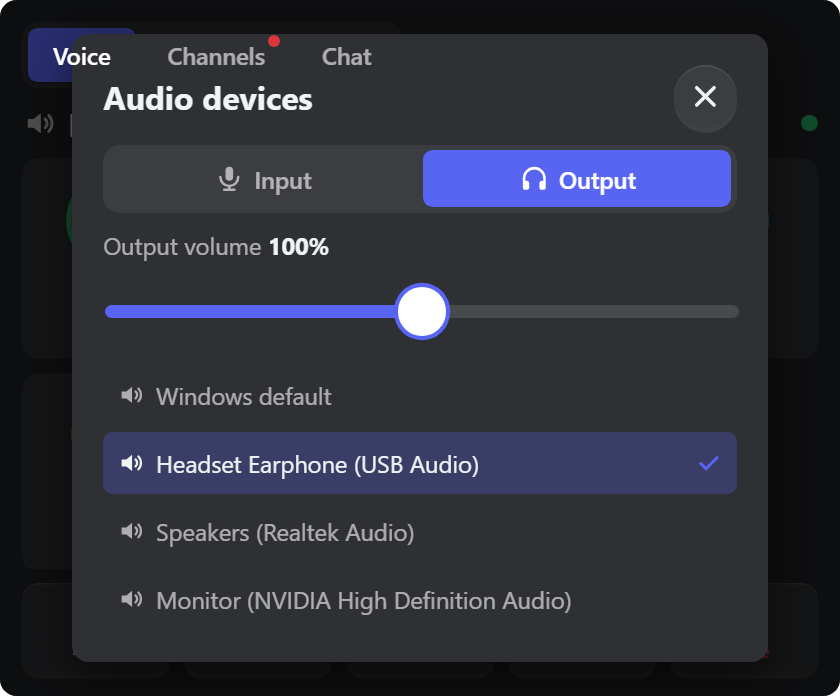
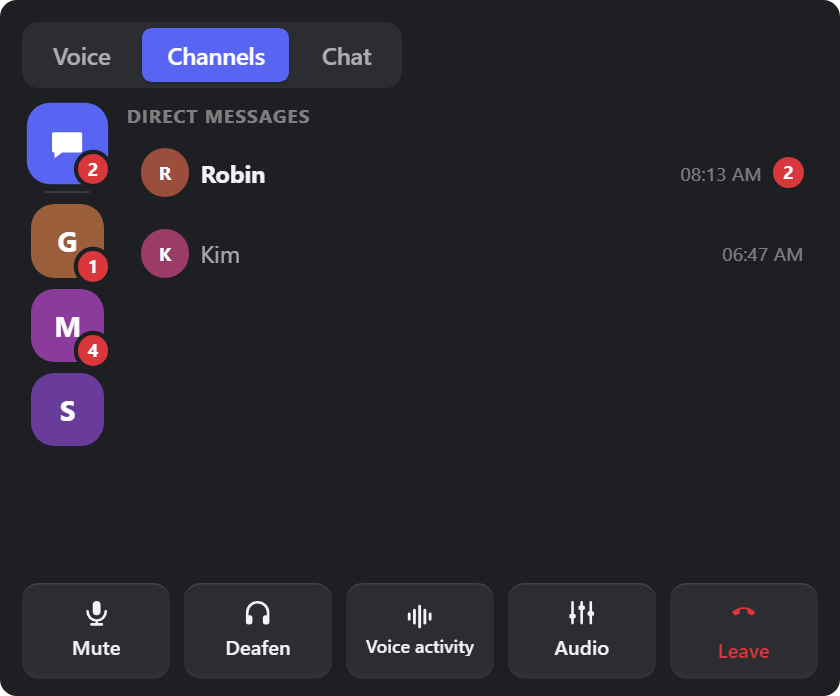
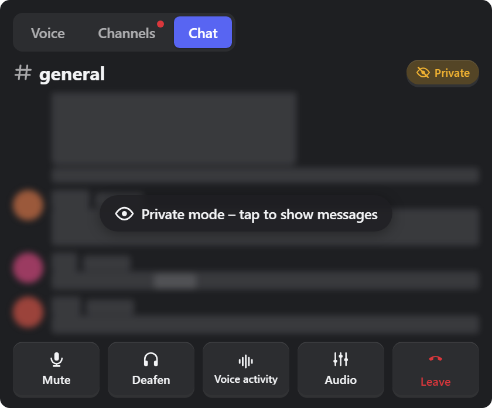
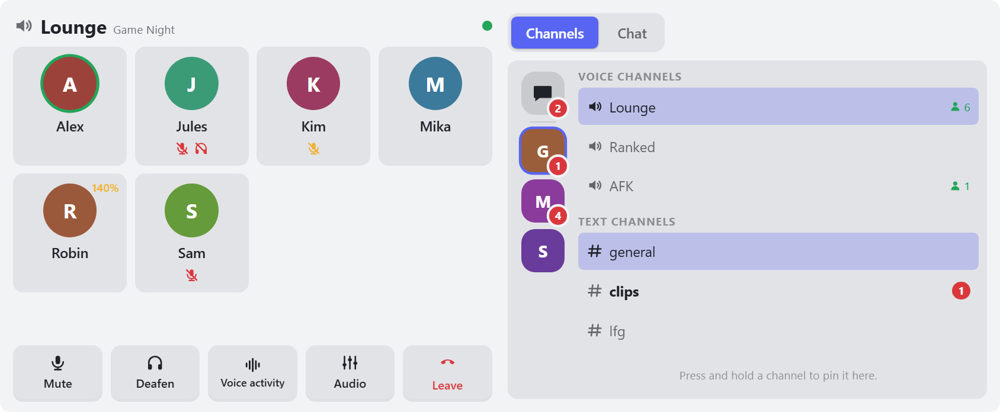
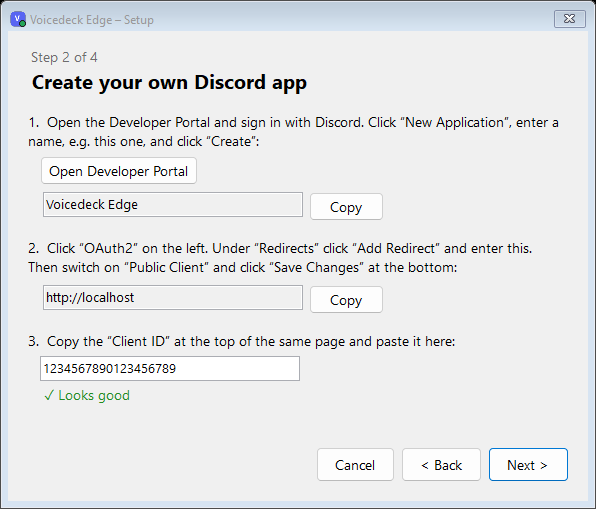

# Voicedeck Edge

**Discord at your fingertips – on the CORSAIR XENEON EDGE.**

See who is talking, mute yourself, turn a friend down, hop channels, read the chat and your direct messages – right on the touchscreen next to your keyboard, without leaving your game.

Free and open source. No account with us, no servers, no tracking.

> 🇩🇪 **[Deutsche Anleitung → README.de.md](README.de.md)**

**[⬇ Download the latest version](https://github.com/KaelanTesseract/voicedeck-edge/releases/latest)** · [Setup guide](docs/SETUP.md#english) · [Privacy](PRIVACY.md#english) · [Project page](https://dennis-guse.de/en/projects/voicedeck-edge.html)

---

## What it does

| | |
|---|---|
|  | **Your voice channel at a glance** Everyone in the channel with avatar and name. A green ring shows who is speaking, red icons show who is muted or deafened. |
|  | **Volume for each person** Tap someone to make them louder or quieter (0–200 %) or mute them just for you. The slider clicks into place at 100 %. |
|  | **Microphone and headphones** The *Audio* button switches Discord's input and output device and sets their volume – handy when you swap between headset and speakers. |
|  | **Servers, channels and direct messages** Your servers in a column like in Discord – press and hold one to move it. Tap a voice channel to join, a text channel to read it. Red numbers show new messages on servers, channels and direct messages. |
|  | **Private mode for streaming** One tap on the eye button hides chat text, pictures and emojis until you tap the chat. |

**Also included**

- 🎙️ **Mute, deafen, voice activity / push to talk** – big buttons that sink under your finger.
- 🎚️ **Audio devices** – pick your microphone and headphones/speakers for Discord and set input and output volume.
- 📞 **Leave the channel** by pressing and holding – no accidental hang-ups.
- ⭐ **Favourites** – press and hold a channel to pin it at the top.
- 🖼️ **Chat with pictures and server emojis**, updating live.
- 🎨 **Dark, light or your iCUE colours**, your own background picture, adjustable text size.
- 📐 **Three sizes:** Medium (tabs), Large (two columns) and XL (everything side by side).

---

## What you need

- Windows 10 or 11 (64-bit)
- CORSAIR iCUE **5.52 or newer** and a **XENEON EDGE**
- The **Discord desktop app** (the version you install, not Discord in the browser)

## Set up in four steps (about 5 minutes)

**1. Install.** Download `VoicedeckEdge-Setup-….exe` from the [latest release](https://github.com/KaelanTesseract/voicedeck-edge/releases/latest) and run it. No admin rights are needed.
If Windows shows *“Windows protected your PC”*, click **More info → Run anyway** (the installer is not code-signed).

**2. Create your own Discord app.** Discord only allows this kind of remote control through your *own* (free) app. The setup assistant opens by itself and walks you through it – with copy buttons for everything you need to enter.

**3. Connect to Discord.** Click **Authorize** in the window Discord shows. That's needed only once.

**4. Add the widget to iCUE.** Click **Add widget to iCUE** in the assistant – iCUE opens and imports it. Place **Voicedeck Edge** on your XENEON EDGE (size M, L or XL) and click **Allow** once when your PC asks *“Allow widget?”*.

Done! A purple **V** in the taskbar shows that the helper (the *hub*) is running; it starts with Windows.

👉 Step-by-step guide with all details and help: **[docs/SETUP.md](docs/SETUP.md#english)**

---

## Tips

- **Pin a channel:** press and hold it until it fills up. Hold again to unpin.
- **Arrange your servers like in Discord:** press and hold a server icon until it lifts, then drag it up or down. Discord doesn't share your own server order with other programs, so you set it once in the widget.
- **Red numbers on servers:** new messages Discord notifies you about (mentions, or every message on servers set to *All messages*). They disappear when you open that channel in the widget – Discord doesn't tell the widget what you've read in the app itself.
- **Leave:** press and hold *Leave* until the red bar is full. (Can be switched to a single tap in the settings.)
- **Direct messages:** speech-bubble icon at the top of the server column. Conversations appear as soon as someone writes to you while the hub is running.
- **Background picture and your own colours:** in the widget settings, switch on **Custom Style** first.
- **Switching pages on the Edge:** iCUE doesn't pass swipes over touch widgets through. Voicedeck Edge turns the page for you – set it up once: in iCUE, open your **XENEON EDGE → device settings** and record **Ctrl + Alt + Shift + Left arrow** for *Previous display screen* and **Ctrl + Alt + Shift + Right arrow** for *Next display screen*. Then just swipe left or right on the widget.

## Settings (in iCUE)

| Setting | What it does |
|---|---|
| Voice layout | Tiles or list |
| Leave: press and hold | Protects against leaving by accident (on by default) |
| Swipe to change pages | Swipe left/right on the widget to turn Edge pages (needs the iCUE shortcut from the tips, on by default) |
| Show chat | Turns chat and text channels on or off |
| Private mode | Starts with the chat hidden (also switchable in the widget) |
| Theme | Automatic (your iCUE colours), dark or light |
| Text size | 80–140 % |
| Background image, brightness, glass blur, transparency | Your own background (with *Custom Style* on) |

## Your privacy

Voicedeck Edge talks only to the Discord app on your PC and to Discord itself. Messages, pictures and names are **never stored** – they live in memory only while they are shown. Your Discord sign-in is encrypted for your Windows account. No telemetry, no tracking, no servers of ours.
Tray icon → **Sign out and delete all data** removes everything at any time. Details: **[PRIVACY.md](PRIVACY.md#english)**

## Good to know

- The widget **shows and controls** – you can't type or send messages with it.
- Camera, screen sharing and the soundboard are not supported.
- Push to talk: the widget switches the mode; it can't press the key for you.
- Channel categories can't be shown (Discord doesn't provide them to local apps).
- Direct messages appear once someone writes to you while the hub runs; the list is not kept after a restart.
- Your server order isn't taken over from Discord (Discord keeps it private) – arrange it once in the widget.
- Red numbers count messages Discord notifies you about while the hub runs. Messages you read in Discord itself stay counted until you open the channel in the widget.

## Help & feedback

Something not working? Check the [troubleshooting table](docs/SETUP.md#troubleshooting) first. Still stuck? [Open an issue](https://github.com/KaelanTesseract/voicedeck-edge/issues) – the log (tray icon → *Open log*) contains no names or messages, so you can attach it.

## Uninstall

Windows Settings → **Apps** → **Voicedeck Edge** → Uninstall. You'll be asked whether to delete all data too (including signing out of Discord). Remove the widget in iCUE.

---

**Developers:** building, testing and how it works inside → [docs/DEVELOPMENT.md](docs/DEVELOPMENT.md)

**Credits:** micro-interactions re-implemented after [interior.dev](https://github.com/ddoemonn/interior) by ozzy (MIT) – see [THIRD_PARTY_NOTICES.md](THIRD_PARTY_NOTICES.md).
**License:** [MIT](LICENSE) © 2026 KaelanTesseract

Voicedeck Edge is an independent project and is not affiliated with, endorsed by or sponsored by Discord Inc. or CORSAIR. Discord, iCUE and XENEON are trademarks of their respective owners. Screenshots show sample data with made-up people.
